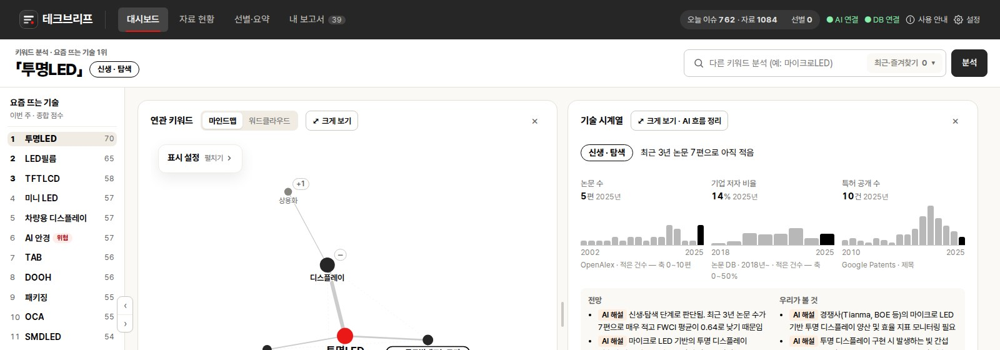
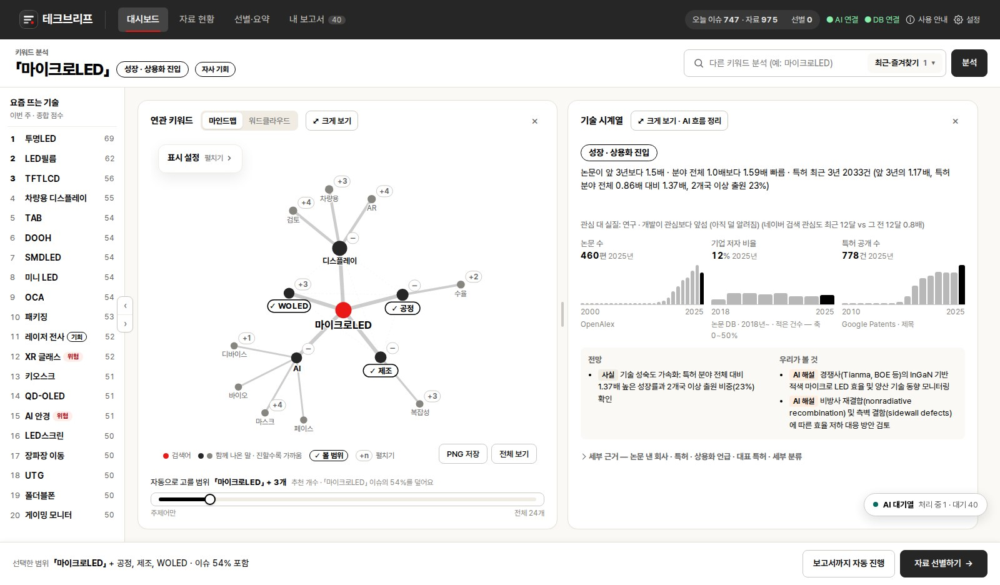
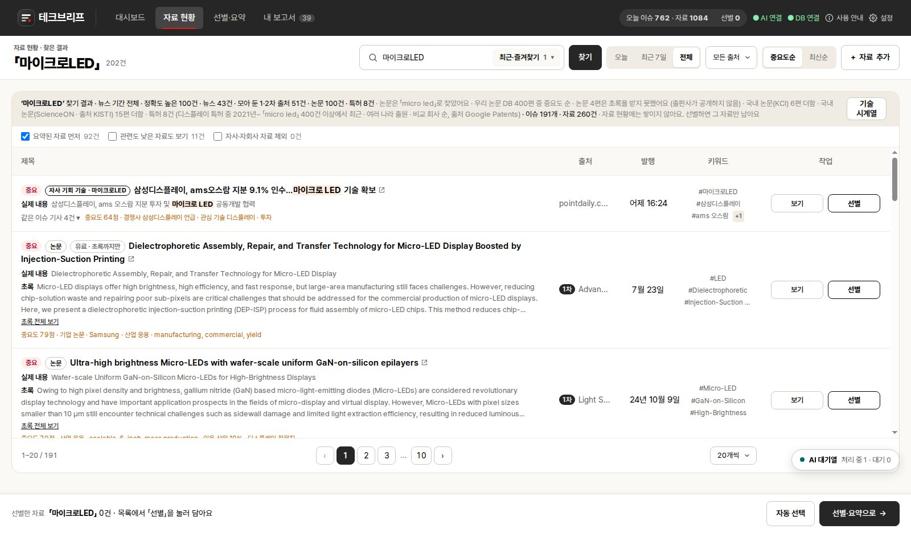
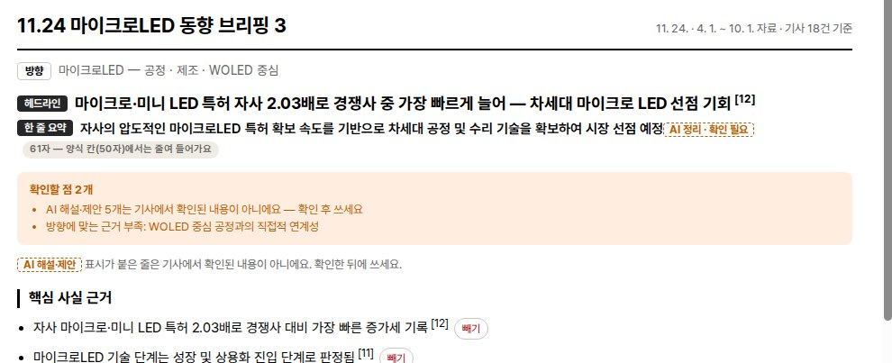

# 테크브리프 (TechBrief)

**새 기술 소식이 온 그날, 「우리 회사에 위협인가 기회인가」를 근거와 함께 보고서 초안으로 만들어 주는 도구**

2026 천안형 글로벌 인재육성사업 · AX 액션러닝 · 5조 최최최종.zip

<table>
<tr>
<td align="center" width="50%">
<h3>🔧 <a href="docs/README.md">개발 문서 자세히 보기 →</a></h3>
판정 규칙 · 근거 대조 · AI 모델 평가 · 시간 실측 · 구조
</td>
<td align="center" width="50%">
<h3>🌐 <a href="https://cheonan-ax-project-production.up.railway.app">운영 사이트 열기 →</a></h3>
접속 코드는 담당자에게 안내
</td>
</tr>
</table>

---

## 이런 문제를 풉니다

디스플레이 회사의 기술 담당자는 새 기술 소식이 오면 그날 안에 보고서 한 편을 올려야 합니다. 기사 · 논문 · 특허를 찾아 읽고, **「그래서 우리 회사에 무슨 뜻인가」를 판단**하고, 회사 양식으로 정리하는 데 **4~5시간**이 걸립니다. → [고객사 요구사항](docs/01_requirements.md)

## 테크브리프는 이렇게 바꿉니다

| | 예전 | 테크브리프 |
| :-- | :-- | :-- |
| 걸리는 시간 | 4~5시간 | **약 2분** (도구 시간 · [실측 조건](docs/07_performance_ops.md)) |
| 재료 | 그때그때 검색 | 매일 모으는 기사 · 1 · 2차 출처 28곳 + **논문 12만 편 · 특허 127만 건** |
| 「우리 회사에 기회인가?」 | 담당자가 감으로 | **특허를 직접 세어 규칙으로 판정** — 예: 마이크로LED 자사 2.03배 vs 경쟁사 최고 1.47배 → 「자사 기회」 ([판정 근거](docs/03_judgment.md)) |
| 믿을 수 있나 | 출처를 다시 찾아 확인 | **문장마다 근거 번호**, 원문과 맞지 않으면 「확인 필요」 ([근거 대조](docs/05_ai_and_evidence.md)) |
| 결과물 | 손으로 양식 맞추기 | **담당자 양식 1페이지 PPT** 그대로 |

## 화면으로 보기

**① 키워드를 넣으면** — 기술 단계 · 특허가 몰린 분야 · 논문 낸 회사를 한 화면에

**② 자료는 중요도 순으로** — 1만 건 중 매일 볼 것만 ([중요도 기준](docs/04_collection_importance.md))

**③ 보고서는 판정이 헤드라인으로** — 근거 번호와 「확인할 점」이 먼저

## 숫자 다섯 개

| | 숫자 | 뜻 |
| :-: | :-- | :-- |
| 1 | **4~5시간** | 담당자가 보고서 한 건에 쓰던 시간 |
| 2 | **127만** | 직접 쌓은 디스플레이 특허 (같은 발명은 한 번만) |
| 3 | **2.03배** | AI가 아니라 규칙으로 계산한 판정 근거 (자사 특허 증가) |
| 4 | **62개** | 1만 건 중 「중요」로 남긴 매일 볼 자료 (11/19 기준, 매일 바뀜) |
| 5 | **약 2분** | 키워드 입력부터 PPT까지 도구가 맡는 시간 |

시간 실측: Vertex AI Gemma 4 26B · 동시 요청 16 · 키워드 4개 중앙값 · 가장 길 때 2분 7초 · 사람이 읽고 고치는 시간 제외 (11/27)

## 더 알아보기

| 궁금한 것 | 문서 |
| :-- | :-- |
| 고객사가 원한 것 | [01 고객사 요구사항](docs/01_requirements.md) |
| 어떻게 돌아가나 | [02 구조 · 데이터 흐름](docs/02_architecture.md) |
| 「기회」 판정은 믿을 만한가 | [03 위협 · 기회 판정](docs/03_judgment.md) |
| 어떤 자료를 어떻게 고르나 | [04 자료 수집 · 중요도](docs/04_collection_importance.md) |
| AI가 지어내면? GPT와 뭐가 다른가 | [05 AI가 하는 일 · 근거 대조](docs/05_ai_and_evidence.md) |
| 어떤 AI 모델을 왜 썼나 | [06 AI 모델 평가](docs/06_model_evaluation.md) |
| 정말 몇 분인가 | [07 걸리는 시간 · 운영](docs/07_performance_ops.md) |
| 회사에서 써도 되나 | [08 데이터 · 약관 · 회사 도입](docs/08_data_terms.md) |
| 화면 · 디자인 | [09 화면 · 디자인](docs/09_design.md) |
| 10주 동안 무엇이 바뀌었나 | [10 10주 과정](docs/10_history.md) |

## 팀

5조 **최최최종.zip** — [@khyun-0123](https://github.com/khyun-0123) (팀장) · [@qwer4022as-ui](https://github.com/qwer4022as-ui) (김동현) · [@jeonghwan415](https://github.com/jeonghwan415)

<b><a href="docs/README.md">🔧 개발 문서 자세히 보기 →</a></b>

