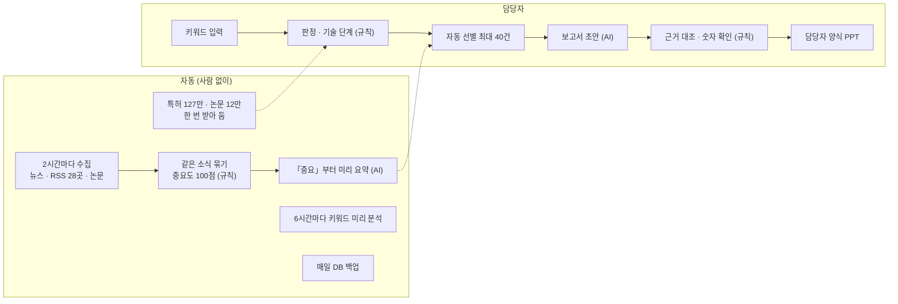
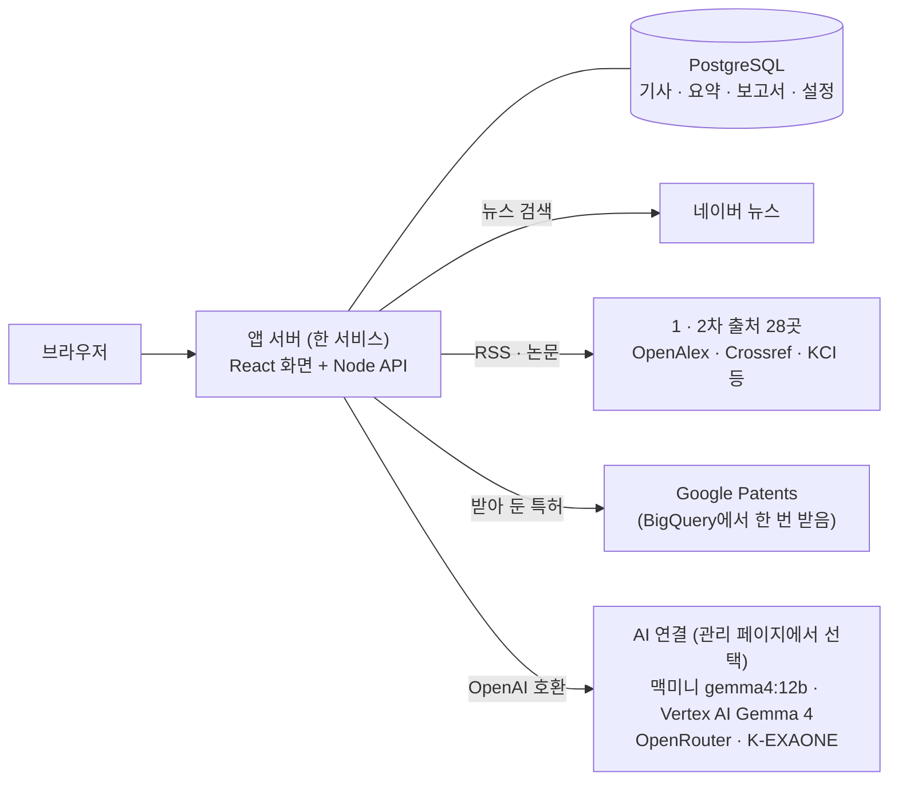

# 02. 구조 · 데이터 흐름

> **이 문서로 알 수 있는 것**
> * 밤사이 자동으로 도는 일과 담당자가 하는 일
> * 화면 · 서버 · DB · AI가 어떻게 연결되는지
> * 회사 안에 설치할 때 무엇이 바뀌는지

## 1. 두 줄 — 밤새 자동, 담당자의 몇 분

* **규칙**이 하는 일: 묶기 · 중요도 · 판정 · 기술 단계 · 근거 대조 · 숫자 확인
* **AI**가 하는 일: 자료 요약 · 보고서 문장 쓰기 · 기술 흐름 정리

## 2. 구성

| 층 | 지금 (공개 데모) | 회사 안에 둘 때 |
| :-- | :-- | :-- |
| 화면 + API | React 19 + Node 22를 **한 서비스**로 (Railway) | 그대로 |
| DB | PostgreSQL 16 · 매일 백업 | 그대로 |
| 수집 | 네이버 뉴스 · RSS 28곳 · 논문 4곳 + 국내 KCI · 특허(받아 둠) | **인터넷 서버에서**, 업무망엔 PDF · PPT만 |
| AI | 맥미니(자체 모델) · Vertex AI · OpenRouter · K-EXAONE 중 선택 | **사내 GPU의 공개 모델** (Gemma 4 26B / 31B) |

* AI 호출은 `server/llm/client.js` 한 곳. OpenAI 호환 방식이라 **주소 · 모델만 바꾸면** 다른 AI로 바뀐다. 연결마다 「동시 요청 수」를 둔다 ([07](07_performance_ops.md)).
* 외부 사이트가 막혀도(예: 봇 차단) 대체 경로 — 브라우저 흉내 → WordPress API → 자체 중계 — 로 받는다.

## 3. 코드에서 찾기

| 하는 일 | 파일 |
| :-- | :-- |
| 수집 · 묶기 · 중요도 | `server/collector/` (`score.js` · `feeds.js` · `index.js`) |
| AI 호출 · 프롬프트 · 근거 대조 | `server/llm/` (`client.js` · `prompts.js` · `reportPrompts.js` · `evidence.js`) |
| 보고서 작업 대기열 | `server/reportJobs.js` |
| 판정 · 특허 | `server/patentDb.js` · `server/keywordBundle.js` · `server/timeline.js` |
| 화면 | `src/` (`Dashboard.jsx` · `KeywordAnalysis.jsx` · `SelectSummary.jsx` · `ReportView.jsx` · `AdminApp.jsx`) |
| 자동 선별 | `src/autoPick.js` |
