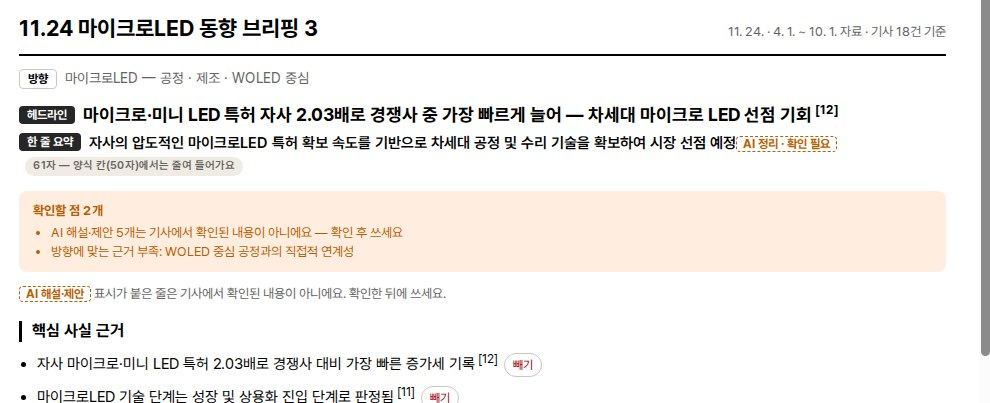
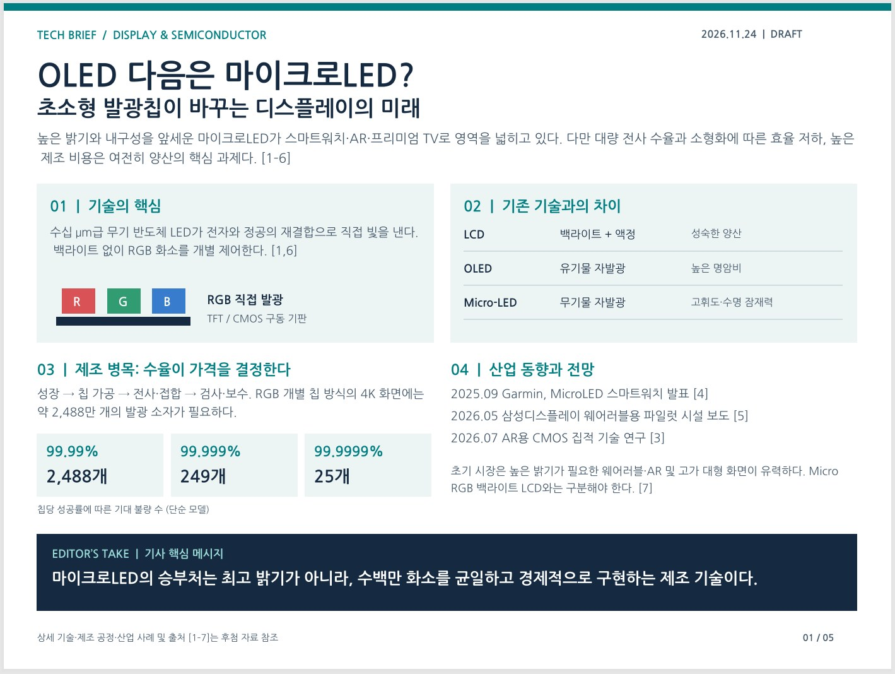

# 05. AI가 하는 일 · 근거 대조

> **이 문서로 알 수 있는 것**
> * AI에게 맡긴 일과 맡기지 않은 일
> * AI가 지어낸 문장을 어떻게 걸러 내는지 (근거 대조 네 겹)
> * 그래도 남는 약점

## 1. 나눈 원칙

| 규칙 (AI 없이) | AI |
| :-- | :-- |
| 같은 소식 묶기 · 중요도 · 자동 선별 | 자료 한 건 6항목 요약 |
| 위협 · 기회 판정 · 기술 단계 ([03](03_judgment.md)) | 보고서 문장 쓰기 |
| 근거 대조 · 숫자 확인 · 「확인할 점」 | 기술 흐름 정리 (배경 · 성장 · 적용 · 전망) |
| 헤드라인의 판정 | 검색어 · 용어 풀이 |

## 2. 근거 대조 네 겹

1. **헤드라인 = 규칙 판정.** AI가 판단을 바꿔 쓰지 못한다.
2. **근거 없이 쓰지 않음.** 보고서의 사실 문장은 모두 수집 자료 번호 [n]에 붙는다. 붙일 근거가 없는 문장은 「AI 해설」로 따로 표시해 사실과 섞이지 않게 한다.
3. **원문과 다시 대조.** 문장과 근거 글의 낱말 겹침이 **0.35 미만이면** 근거 번호를 지우고 「AI 해설 · 확인 필요」를 붙인다.
   * 기준값을 정한 방법: 실측해 보니 진짜 근거가 있는 문장은 0.39 이상, AI가 덧붙인 말은 0.33 이하 → 그 사이 0.35. 관리 페이지 「세부 설정」에서 바꿀 수 있다.
4. **숫자 확인.** 사실 문장의 숫자가 근거 글에 없으면 표시한다 (실측: 2.04배를 「2.1배」로 반올림한 것을 잡음).

* 이렇게 걸린 줄과 근거를 못 찾은 AI 해설은 보고서 **맨 위 「확인할 점」**에 모아, 사람이 먼저 보게 한다.

## 3. 요약 6항목

자료 한 건을 **컨셉 · 원리 · 장단점 · 타사 현황 · 활용 방안 · 효과성**으로 요약하고, 항목마다 근거를 나눈다.

| 표시 | 뜻 |
| :-- | :-- |
| 기사 근거 [n] | 원문에서 확인된 내용 |
| AI 보충 · 확인 필요 | 원문에 없어 AI가 일반 지식으로 채운 내용 (겹침이 낮으면 서버가 자동으로 이 표시로 바꿈) |
| AI 제안 | 활용 방안처럼 AI의 의견 |

## 4. GPT에 물으면 무엇이 다른가

| GPT 채팅창 | 테크브리프 |
| :-- | :-- |
| 내가 자료를 찾아 붙여야 함 · 학습 시점까지만 | 매일 자동 수집 (기사 · 1 · 2차 28곳 · 논문 · 특허) |
| 「기회인가」를 그럴듯하게 **말로** | 특허 127만 건을 세어 **숫자로 판정** |
| 회사 · 경쟁사를 매번 설명 | 자사 · 경쟁사 · 소부장 목록이 점수에 들어 있음 |
| 출처 번호가 있어도 원문과 대조 안 함 | 문장마다 근거 번호 + 원문 대조 |
| 양식을 매번 다시 맞춤 | 담당자 양식 1페이지 PPT |

같은 요청으로 ChatGPT가 만든 보고서 (팀, 11/24). 보기 좋고 출처 번호도 붙지만, 우리 회사 기준 판정 · 특허 수 · 원문 대조가 없다.

## 5. 남는 약점

* 숫자는 맞지만 **비교 대상**(「무엇 대비 2배」)을 AI가 바꿔 쓰면 숫자 확인을 통과한다 → 사람이 확인. 그래서 「초안」이라 부른다.
* 낱말 겹침은 뜻이 같은 다른 표현(의역)을 놓칠 수 있다 → 기준값을 낮게 잡고 「확인 필요」로 남기는 쪽을 택했다.

코드: `server/llm/evidence.js` · `server/llm/prompts.js` · `server/llm/reportPrompts.js`
