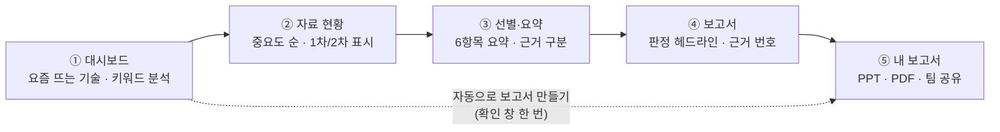
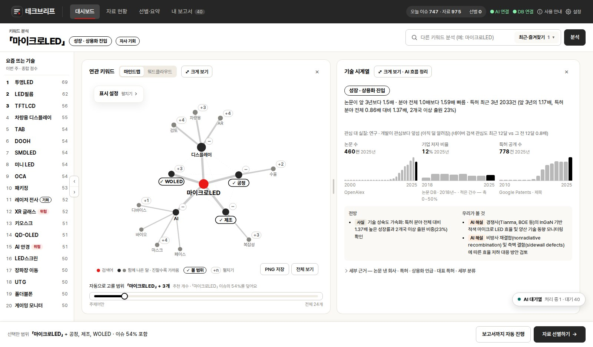
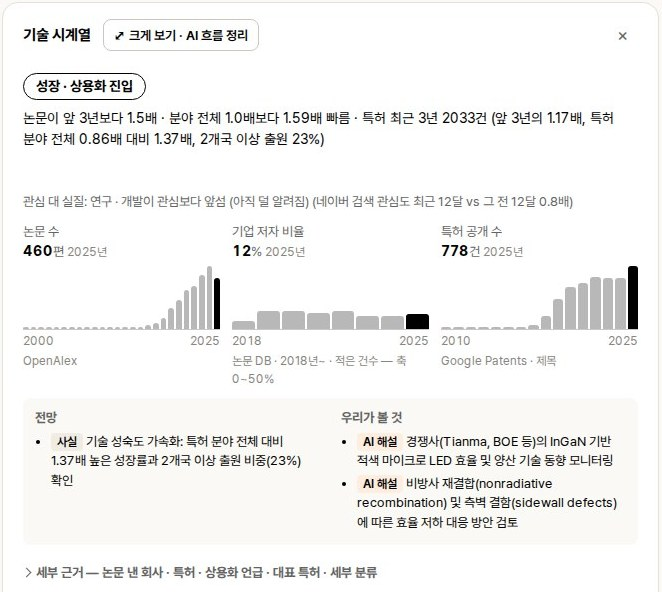
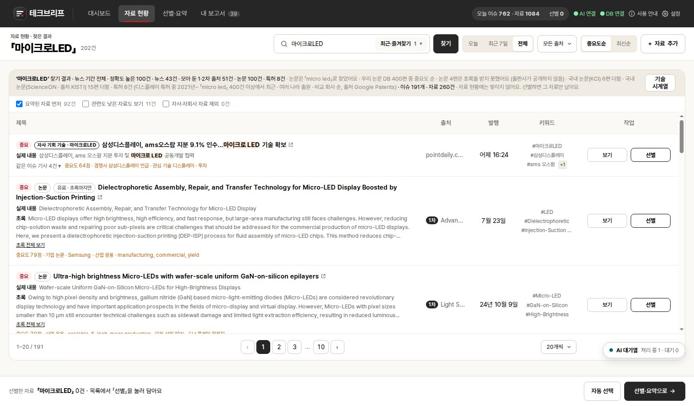

# 09. 화면 · 디자인

> **이 문서로 알 수 있는 것**
> * 화면 구성과 사용 흐름
> * 디자인 기준(토큰 · 여백 규칙)

## 1. 사용 흐름

| 화면 | 한 일 |
| :-- | :-- |
| 대시보드 | 왼쪽 「요즘 뜨는 기술」(평소 대비 신호 점수 · 자사 위협/기회 표시), 오른쪽 **연관 키워드 맵 + 기술 시계열**을 비율 조절 두 칸으로 |
| 자료 현황 | 같은 이슈 묶음, 출처 1차/2차, 중요도 점수와 이유를 제목 아래 그대로 |
| 선별·요약 | 6항목 요약, 기사 근거 / AI 보충 / AI 제안 표시 |
| 보고서 | 1페이지(헤드라인 · 핵심 사실 · 시사점) + 유첨, 「확인할 점」 맨 위 |
| 관리 페이지 | 수집 출처 · 중요도 · 판정 기준 · AI 연결 · 운영, 저장 안 한 변경 경고 |

## 2. 디자인 기준

* **디자인 토큰:** 색 · 글꼴 · 간격을 토큰(`src/tokens.css`)으로만 쓴다. 라이트 · 다크 전환.
* **여백 규칙:** 카드 안쪽 · 카드 사이 간격을 공통 토큰으로. 새 화면은 1440 · 1280 · 390px 폭에서 확인.
* **버튼 체계:** 크기 40 · 32, 역할마다 모양(주요 · 보조 · 위험).
* **처음 방문 안내:** 화면을 차례로 짚는 8단계 사용 안내.
* **부품 카탈로그:** Storybook (`npm run storybook`).
