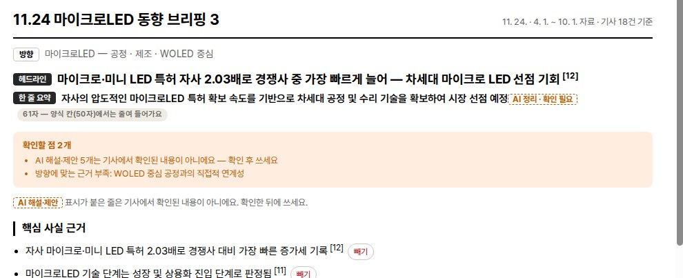

# 테크브리프 — 개발 문서

<table>
<tr>
<td width="60%">

### 👀 처음이라면 — [쉽게 보는 소개 →](../README.md)

**새 기술 소식이 온 그날, 「우리 회사에 위협인가 기회인가」를 근거와 함께 보고서 초안으로.**

* 보고서 한 건 **4~5시간 → 약 2분** (도구 시간, 11/27 실측)
* 특허 **127만 건**을 직접 세어 **규칙으로 판정** — 판단을 AI에게 맡기지 않음
* 문장마다 **근거 번호**, 원문과 다르면 「확인 필요」
* 담당자 양식 **1페이지 PPT** 그대로

[🌐 운영 사이트](https://cheonan-ax-project-production.up.railway.app) · 2026 천안형 글로벌 인재육성사업 AX 액션러닝 5조 최최최종.zip

</td>
<td width="40%"></td>
</tr>
</table>

---

## 문서 — 이 순서로 읽으면 됩니다

| | 문서 | 한 줄 |
| :-: | :-- | :-- |
| 1 | [**고객사 요구사항**](01_requirements.md) | 무엇을 풀려고 했나 — 4~5시간 · 「우리에게 주는 의미」 · 망 분리 |
| 2 | [**구조 · 데이터 흐름**](02_architecture.md) | 밤새 자동 / 담당자의 몇 분, 회사 안에 둘 때 바뀌는 두 곳 |
| 3 | [**위협 · 기회 판정**](03_judgment.md) | 2.03배는 어떻게 나왔나 — 계산식 · 기준 · 12개 검증 · 한계 |
| 4 | [**자료 수집 · 중요도**](04_collection_importance.md) | 출처 28곳 + 논문 · 특허, 100점 기준, 1만 건 → 62개 |
| 5 | [**AI가 하는 일 · 근거 대조**](05_ai_and_evidence.md) | 규칙과 AI의 역할, 근거 대조 네 겹, GPT와 무엇이 다른가 |
| 6 | [**AI 모델 평가**](06_model_evaluation.md) | 12개 모델 · 작업 4종 · 채점자 둘, 상황별 추천 |
| 7 | [**걸리는 시간 · 운영**](07_performance_ops.md) | 키워드 → PPT 약 2분 (조건 포함), 자료 종류 · 건수별 시간, 운영 |
| 8 | [**데이터 · 약관 · 회사 도입**](08_data_terms.md) | 데이터별 이용 조건, 사내 설치 때 확인할 것 |
| 9 | [**화면 · 디자인**](09_design.md) | 사용 흐름, 디자인 토큰 · 여백 규칙 |
| 10 | [**10주 과정**](10_history.md) | 받은 말 → 바꾼 것, 틀렸던 것, 다음 단계 |

<sub>이 문서들은 팀의 개발 일지(52편, 비공개)를 **주제별로 다시 정리**한 것입니다. 인터뷰 원문 · 회의 · 개인 정보는 싣지 않습니다.</sub>

## 핵심 설계 세 줄

1. **판단은 규칙, 읽고 쓰기만 AI** — 중요도 · 판정 · 기술 단계 · 근거 대조는 AI 없이 계산 ([03](03_judgment.md) · [05](05_ai_and_evidence.md))
2. **AI가 틀려도 알아챌 수 있게** — 근거 번호 · 원문 대조 0.35 · 숫자 확인 · 「확인할 점」 맨 위 ([05](05_ai_and_evidence.md))
3. **AI는 갈아 끼울 수 있게** — OpenAI 호환 한 곳에서 호출, 관리 페이지에서 연결 · 동시 요청 수 선택 ([02](02_architecture.md) · [06](06_model_evaluation.md))

## 기술 스택

| 영역 | 기술 |
| :-- | :-- |
| 화면 | React 19 · Vite 8 · 디자인 토큰 · Storybook |
| 서버 | Node.js 22 (Vite 미들웨어로 API를 함께 실행, 별도 프레임워크 없음) |
| DB | PostgreSQL 16 (앱을 켤 때 테이블 자동 생성) |
| AI | OpenAI 호환 Chat Completions + JSON 스키마 출력 — 맥미니(Ollama) · Vertex AI · OpenRouter · K-EXAONE |
| 데이터 | 네이버 뉴스 · RSS 28곳 · OpenAlex · Crossref · KCI · Google Patents(BigQuery) |
| 원문 · 내보내기 | `@mozilla/readability` · `jsdom` · `pptxgenjs` |
| 분석 | Kiwi(형태소, 명사 추출) · TimesFM(예상 밖 급증) |

## 폴더

```
src/          화면 — 대시보드 · 키워드 분석 · 자료 현황 · 선별·요약 · 보고서 · 관리 페이지
server/       API
  collector/    수집 · 같은 소식 묶기 · 중요도(score.js) · RSS(feeds.js)
  llm/          AI 호출(client.js) · 프롬프트 · 근거 대조(evidence.js)
  db/           PostgreSQL
  patentDb.js · timeline.js · keywordBundle.js   특허 · 기술 시계열 · 분석 묶음
  reportJobs.js   보고서 작업 대기열
scripts/      서버 감시 · 특허 자료 받기 · 피드 중계
templates/    보고서 양식 PPT
docs/         이 문서들
```

## 실행

```bash
npm install
cp .env.example .env.local   # 값 채우기 — 설명은 .env.example 안에
npm run dev                  # 화면 + API (http://localhost:5173)
```

* 필수는 Node.js 22. PostgreSQL · AI 서버 · 네이버 키가 없으면 그 기능만 꺼진다.
* `npm run storybook` 부품 카탈로그 · `npm run patent-db` 특허 자료 받기 · `npm run lint` 검사

## 팀

5조 최최최종.zip — [@khyun-0123](https://github.com/khyun-0123) (팀장) · [@qwer4022as-ui](https://github.com/qwer4022as-ui) (김동현) · [@jeonghwan415](https://github.com/jeonghwan415)

---

<p align="center"><b><a href="../README.md">👀 쉽게 보는 소개</a></b> · <a href="https://cheonan-ax-project-production.up.railway.app">🌐 운영 사이트</a></p>
